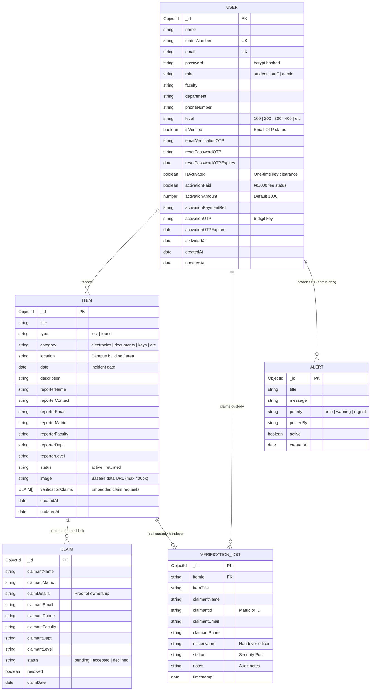
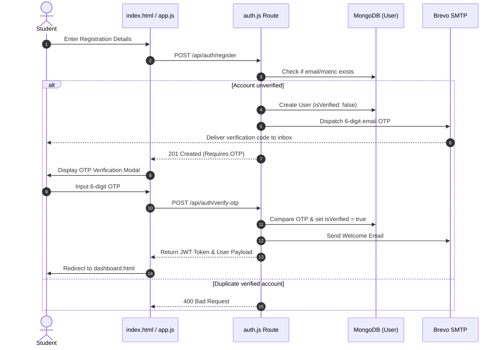
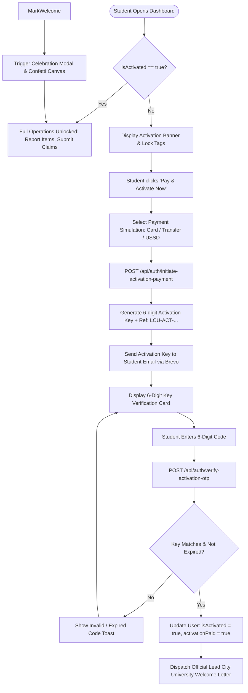
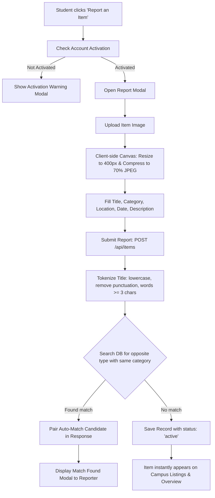
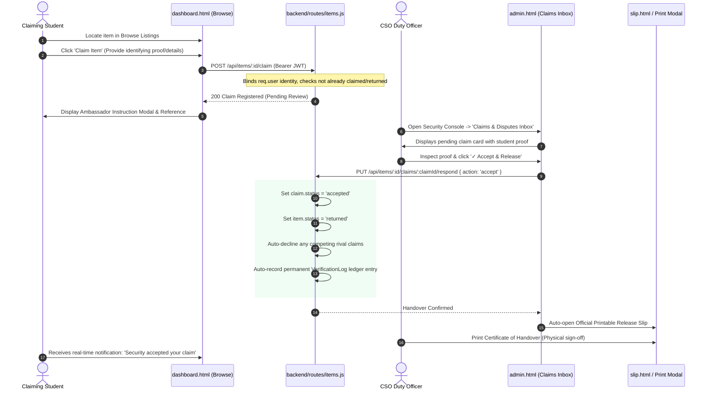

# 🛡️ LCU FindMe — Campus Property Recovery Platform
## Complete System Documentation, Database Schema & Operational Logic Flows

---

## 1. Executive System Architecture

**LCU FindMe** is an institutional lost-and-found operations platform designed for **Lead City University (LCU), Ibadan**. It connects students, campus security officers, and administrators through a synchronized system that pairs digital reports with physical property custody.

### Technology Stack
* **Frontend:** Vanilla JavaScript (ES6+), HTML5, Semantic CSS3 with CSS Custom Properties, Canvas image compression, PWA Service Worker (`sw.js`).
* **Backend:** Node.js with Express REST APIs, JWT Bearer Token Authentication, Bcrypt password hashing.
* **Database:** MongoDB Atlas (Mongoose ODM).
* **Communication & Mail:** Brevo (Sendinblue) Transactional SMTP API with branded responsive HTML email templates.
* **Physical Tracking:** Client-side QR generation (`qrGenerator.js` / HTML5 Canvas) & QR camera barcode scanner (`html5-qrcode`).

---

## 2. Entity-Relationship (ER) Database Diagram

---

## 3. Core Logic & Workflow Diagrams

### 3.1 Student Authentication & Account Security Flow

---

### 3.2 One-Time Security Activation Key Workflow

To protect student identities and ensure accountable use, students activate their dashboard clearance with a simulated institutional one-time fee:

---

### 3.3 Item Reporting & Fuzzy Auto-Matching Flow

---

### 3.4 Verification, Claiming & Custody Handover Flow

---

## 4. Role-Based Access Control (RBAC) & Default Credentials

| Portal Page | Access Scope | Role Required | Default Credentials |
|:---|:---|:---|:---|
| `index.html` | Public landing, student login, registration, password recovery | Everyone (`public`) | Any registered student |
| `dashboard.html` | Student personal reports, claims submission, browse listings, profile | Authenticated student / staff | Created during sign up |
| `admin.html` | Security Operations Center: claims inbox, student directory, intake, custody ledger, QR scanner | `admin` | **Email:** `admin@lcu.edu.ng` **Password:** `admin123` |
| `slip.html` | Standalone property inspection and official release certification via QR | `public` / physical scan | Open to any valid `?item=<id>` |

---

## 5. End-to-End Operational Guide

### 5.1 Student User Walkthrough

1. **Sign Up / Login:**
   * Go to `index.html`.
   * Fill out the student registration form using your **LCU Matriculation Number** (e.g. `LCU/UG/23/25454`) and active email.
   * Check your email for the 6-digit OTP to verify your account.
2. **Dashboard Overview:**
   * Once logged in, your personal metrics are displayed at the top: **My Total Reports**, **Active Lost Reports**, **Items Returned**, and **Campus Listings**.
   * Clicking **any metric card** automatically routes you directly to its respective page or pre-filtered tab.
3. **One-Time Security Activation:**
   * Before reporting or claiming, click **"Pay & Activate Now"**.
   * Confirm the payment simulation to receive your **6-Digit Activation Key** via email.
   * Enter the code to permanently unlock all dashboard privileges.
4. **Reporting Lost or Found Property:**
   * Tap the **"+" Report** button (on desktop: top-right banner; on mobile: floating pill center FAB).
   * Upload a photo (compressed automatically on-device) and provide description, location, and date.
5. **Claiming a Recovered Item:**
   * Go to **Browse Listings**, find the item, and tap **"Claim Item"**.
   * Input confidential proof of ownership (e.g., serial number, distinctive scratch, wallpaper description).
   * Visit the Campus Security Desk (Gate A) to receive your property.

---

### 5.2 Campus Security Officer (CSO) Walkthrough

1. **Accessing the Console:**
   * Open `admin.html`. The screen displays the locked **Security Portal Gate**.
   * Enter `admin@lcu.edu.ng` and password `admin123`.
2. **Operations Dashboard (Tab 1):**
   * Real-time KPI counters (Total, Active Lost, Active Found, Returned, Pending Claims).
   * Review all campus items, filter by status (`claims_pending`, `active`, `returned`), or export full CSV inventory.
3. **Claims & Disputes Inbox (Tab 2):**
   * Review incoming student claims.
   * Compare claimant details against the item record.
   * Click **"✓ Accept & Release"** to grant ownership, or **"Decline"** if proof is insufficient.
4. **Permanent Chain of Custody Ledger (Tab 3):**
   * Every accepted claim and manual handover is permanently immutably logged with timestamp, officer name, claimant ID, and proof notes.
   * Export handover ledger to CSV for campus audits.
5. **Student User Directory (Tab 4):**
   * Search students by name, matric number, faculty, or department.
   * Security officers can **manually toggle activation** if a student pays cash directly at the desk.
6. **Security Property Intake (Tab 5):**
   * Direct intake of found items handed in by cleaners, lecturers, or anonymous students.
   * Assigns intake storage bin codes (e.g. `BIN-A3`) and immediately posts item to the campus board.
7. **QR Barcode Scanner:**
   * Click **"Scan QR Tag"** in the top bar to open the camera scanner or enter an item ID manually to pull up any item's custody slip.

---

## 6. Key REST API Endpoint Reference

| Method | Endpoint | Protection | Description |
|:---|:---|:---|:---|
| `POST` | `/api/auth/register` | Public | Register new student or staff account |
| `POST` | `/api/auth/verify-otp` | Public | Verify 6-digit registration OTP |
| `POST` | `/api/auth/login` | Public | Authenticate user & return JWT token |
| `POST` | `/api/auth/initiate-activation-payment` | JWT User | Simulate activation fee & dispatch email key |
| `POST` | `/api/auth/verify-activation-otp` | JWT User | Verify activation key & unlock dashboard |
| `GET` | `/api/items` | Public | Query filtered items (type, category, search) |
| `POST` | `/api/items` | JWT (Activated) | Submit new lost or found property report |
| `POST` | `/api/items/:id/claim` | JWT (Activated) | Submit ownership verification claim |
| `PUT` | `/api/items/:id/claims/:claimId/respond`| Admin Only | Accept or decline student claim |
| `PUT` | `/api/items/:id/resolve` | Admin Only | Mark item as returned and close claims |
| `GET` | `/api/admin/stats` | Admin Only | Aggregate security metrics & analytics |
| `GET` | `/api/admin/users` | Admin Only | Search and filter campus student directory |
| `PUT` | `/api/admin/users/:id/activation` | Admin Only | Security override for student activation |
| `POST` | `/api/admin/verifications` | Admin Only | Record in-person physical custody handover |
| `POST` | `/api/admin/intake` | Admin Only | Direct gate intake of recovered property |
| `POST` | `/api/admin/alerts` | Admin Only | Broadcast campus security notices |

